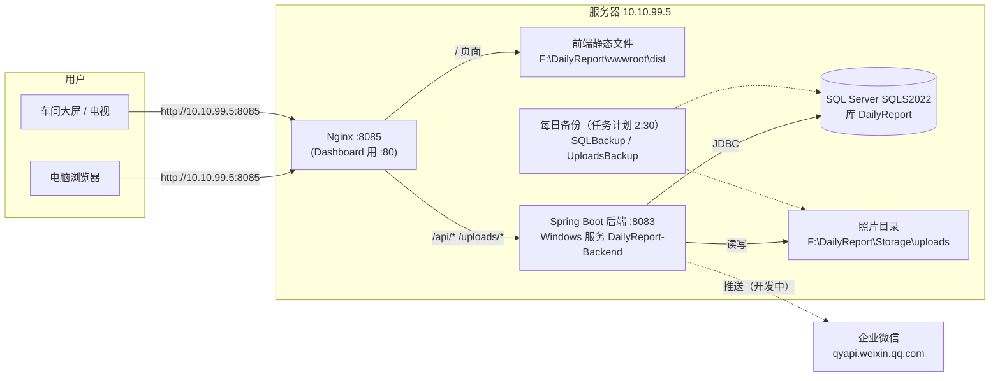
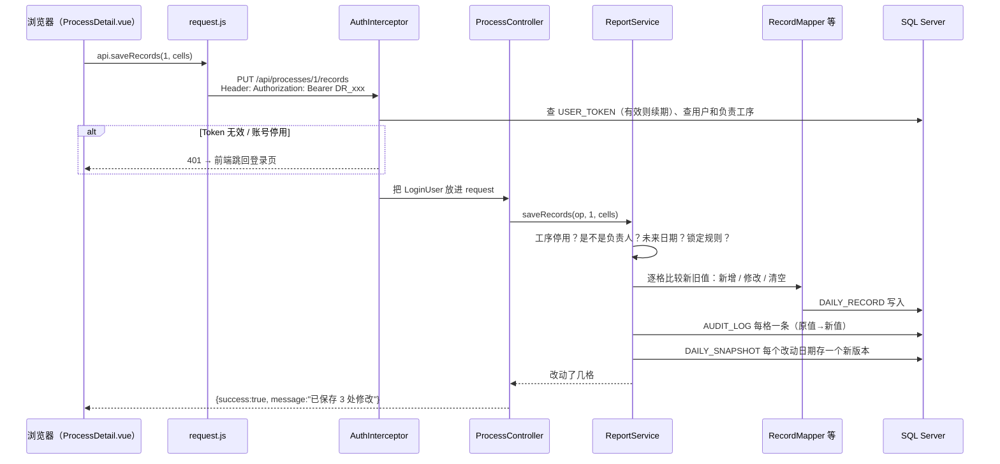
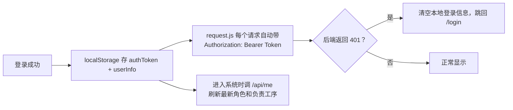
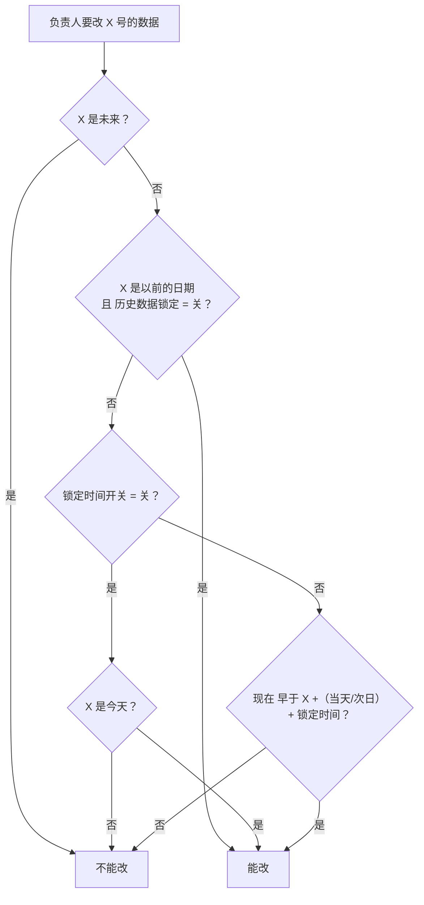
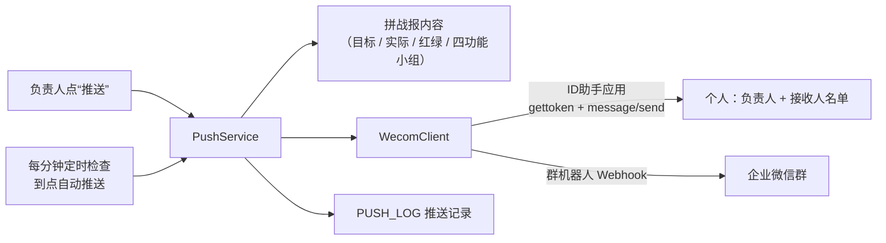

# 每日战报系统 架构说明

> 写给自己看的系统地图：先看第 1、2 节建立整体印象，再按需要查后面的章节。
> 最后更新：2026-10-24。企业微信推送（第 9 节）已开发完成，但**还没提交、没上线**。

---

## 1. 一句话概览

各工序负责人每天在网页上填“六项自主保证”（安全、品质、交付、报废、成本、设备）的实际数值，系统按每道工序自己的目标自动判红绿，首页汇总全厂达标情况，车间大屏轮播展示，每一次修改都留痕可追溯。

| 层 | 技术 | 说明 |
|---|---|---|
| 前端 | Vue 3 + Vue CLI 5 + Element Plus 2.14 + ECharts 6 + axios | 跟 Dashboard 项目同一套 |
| 后端 | Spring Boot 3.2.5 + Java 17 + JdbcTemplate | 不用 JPA / MyBatis，SQL 手写在 Mapper 里 |
| 数据库 | SQL Server 2022（实例 SQLS2022），库名 `DailyReport` | 跟 Dashboard 共用同一个 SQL Server，各用各的库 |
| 部署 | Nginx（托管前端 + 反向代理）+ NSSM（把后端注册成 Windows 服务） | 服务器 10.10.99.5，跟 Dashboard 同一台 |

---

## 2. 整体架构



**要点**

- 浏览器只跟 Nginx（8085）打交道。页面文件 Nginx 自己给；`/api/*`（接口）和 `/uploads/*`（照片）转给后端 8083。后端只在服务器本机监听，外面不能直接连。
- 前端是“单页应用”：只有一个 `index.html`，切换页面不刷新，靠前端路由（`/processes/1` 这种地址）。所以 Nginx 配了“找不到文件就返回 index.html”。
- 开发时不经过 Nginx：前端 `npm run serve` 跑在 8084，直接跨域调后端 8083（后端开了 CORS）。

---

## 3. 目录结构

```
DailyReport/
├─ Backend/backend/                 后端（Spring Boot）
│  ├─ pom.xml                       依赖：web、jdbc、mssql-jdbc、spring-security-crypto
│  ├─ config/application-local.properties   开发机数据库密码（不提交 git）
│  └─ src/main/
│     ├─ java/com/welltek/backend/
│     │  ├─ BackendApplication.java 启动入口
│     │  ├─ config/       全局配置：拦截器注册、异常处理、启动时建表/升级/初始数据、定时任务
│     │  ├─ security/     登录与权限：Token、拦截器、权限注解、当前用户
│     │  ├─ controller/   接口层：接收请求、取参数、调 Service、返回 ApiResult
│     │  ├─ service/      业务层：权限判断、业务规则、记操作日志
│     │  ├─ mapper/       数据层：一张表一个类，手写 SQL（JdbcTemplate）
│     │  ├─ entity/       数据对象（record）和枚举（角色、六项指标、达标状态）
│     │  └─ dto/          接口的统一返回 ApiResult、请求体 Requests
│     └─ resources/
│        ├─ application.properties  公共配置（端口、数据源、上传、企业微信参数占位）
│        └─ db/schema.sql           建表脚本（表不存在才建）
├─ Frontend/frontend/               前端（Vue 3）
│  ├─ .env.development / .env.production   后端地址（开发 8083；正式留空=同域名）
│  ├─ vue.config.js                 开发端口 8084
│  └─ src/
│     ├─ main.js / App.vue          入口、外框（侧边栏 + 顶栏）
│     ├─ router/index.js            路由表 + 登录 / 权限守卫 + 侧边栏菜单生成
│     ├─ api/index.js               所有后端接口汇总
│     ├─ utils/request.js           axios：自动带 Token，401 跳登录页
│     ├─ utils/format.js            数字、日期、图片地址格式化
│     ├─ composables/               useAuth（登录状态）、useFullscreen、useDailyReload
│     ├─ components/                EChart（图表封装）、ImageUpload（单张图片上传）
│     └─ views/                     页面（见第 6 节）
├─ deploy/
│  ├─ nginx/dailyreport.conf        Nginx 配置（8085）
│  └─ application-prod.properties.example   正式环境配置模板
├─ scripts/
│  ├─ install-on-server.ps1         第一次安装到服务器
│  ├─ deploy-to-prod.ps1           以后更新代码
│  ├─ install-backup-task.ps1      安装每日备份任务
│  ├─ server-local/backup-dailyreport.ps1   服务器本机跑的备份脚本
│  ├─ sql/                         需要手动在服务器跑的 SQL（目前只有建库）
│  └─ 说明.txt                     部署、备份、企业微信的操作说明
└─ docs/架构说明.md                 本文档
```

---

## 4. 后端

### 4.1 一个请求是怎么走完的

以“负责人保存走势表”为例：



**统一约定**

- 所有接口返回 `ApiResult`：`{ success, message, data }`。
- **业务失败**（没权限改、数据已锁定、用户名重复……）返回 HTTP 200 + `success:false` + 中文提示。前端统一弹 `message`。
- 只有“没登录 / 登录过期 / 账号停用”返回 **401**，“权限不够”返回 **403**，“地址不存在”返回 **404**。
- Service 里校验不通过就 `throw new BizException("提示文字")`，由 `GlobalExceptionHandler` 转成 `success:false`。同时 `@Transactional` 会回滚已经写了一半的数据。

### 4.2 各包、各类的职责

| 包 | 类 | 干什么 |
|---|---|---|
| config | `WebMvcConfig` | 注册权限拦截器（拦 `/api/**`，放行登录、登出）、开 CORS |
| | `GlobalExceptionHandler` | BizException → 业务提示；404 / 405；其他异常记日志，返回“服务器出错了” |
| | `SchemaMigrator` | 老库加列（ACCOUNT、MEMBERS、WECOM_USERID），先检查再改，重复启动没影响 |
| | `DataInitializer` | 启动时：执行 SchemaMigrator → 用户表为空才建初始账号 → 工序表为空才建 25 道工序 → 补齐每道工序的六项默认目标 |
| | `SchedulingConfig` | 每分钟检查一次是否到了企业微信自动推送时间（开发中） |
| security | `AuthInterceptor` | 校验 Token、加载最新的用户和负责工序；`@RequireAdmin` / `@RequireSysAdmin` 不满足返回 403 |
| | `TokenStore` | Token 存在 `USER_TOKEN` 表，无操作 12 小时失效（每次访问自动续期） |
| | `LoginUser` | 当前用户：id、账号、用户名、角色、负责工序；`canEdit(工序)` |
| | `PasswordConfig` | BCrypt 加密密码 |
| controller | `LoginController` | 登录、登出、当前用户、改自己的密码 |
| | `UserController` | 用户增删改、重置密码、分配负责工序 |
| | `ProcessController` | 工序列表 / 配置 / 负责人；工序详情、保存走势表 / 目标 / 看板；修改记录、留底版本；推送 |
| | `DashboardController` | 首页汇总、操作日志、图片上传 |
| | `SettingController` | 系统设置：图片存储路径、数据锁定、企业微信推送 |
| | `UploadFileController` | 显示照片 `/uploads/yyyyMM/xxx.png`（先找当前存储路径，再找历史路径） |
| service | `UserService` | 用户管理的所有规则（见 5.1） |
| | `ProcessService` | 工序卡片统计、工序增改 / 停用、负责人分配、默认目标 |
| | `ReportService` | 工序详情：走势表保存（锁定、留痕、快照）、目标、班组看板 |
| | `DashboardService` | 全厂汇总：各指标达标率、工序×指标矩阵、当月走势 |
| | `SettingService` | 图片存储路径（含迁移）、数据锁定规则 `ownerCanEdit` |
| | `AuditService` | 写操作日志、分页查询 |
| | `FileService` | 保存上传的图片（只收图片格式，随机文件名） |
| | `PushService` / `WecomClient` | 企业微信推送（开发中，见第 9 节） |
| mapper | 一张表一个 | `UserMapper`、`ProcessMapper`、`TargetMapper`、`RecordMapper`、`SnapshotMapper`、`BoardMapper`、`AuditMapper`、`SettingMapper`、`PushLogMapper` |

### 4.3 启动时发生了什么

1. Spring Boot 执行 `db/schema.sql`：每张表都是 `IF OBJECT_ID(...) IS NULL CREATE TABLE`，**已存在就跳过**，不会动数据。
2. `DataInitializer` → `SchemaMigrator`：给老表补新列。
3. 用户表为空（第一次部署）→ 建初始账号“系统管理员 / admin”“叶丰龙 / 0625”。
4. 工序表为空 → 建 25 道默认工序；每道工序缺哪项目标就补哪项默认目标。

所以**部署新版本不需要手动跑 SQL**。表结构的变化都写在 schema.sql（新表）或 SchemaMigrator（老表加列）里，后端启动时自动完成。

---

## 5. 数据库

### 5.1 表关系

```mermaid
erDiagram
    SYS_USER ||--o{ USER_PROCESS : "负责"
    PROCESS_STEP ||--o{ USER_PROCESS : "被负责"
    PROCESS_STEP ||--|{ METRIC_TARGET : "六项目标（文字）"
    PROCESS_STEP ||--|{ METRIC_ITEM : "子项（判定规则）"
    METRIC_ITEM ||--o{ DAILY_RECORD : "每日数据"
    PROCESS_STEP ||--o{ DAILY_SNAPSHOT : "留底版本"
    PROCESS_STEP ||--o| PROCESS_BOARD : "四功能小组"
    PROCESS_STEP ||--o{ DAILY_NOTE : "每天的行动与亮点"
    SYS_USER ||--o{ USER_TOKEN : "登录"

    SYS_USER { int ID PK; nvarchar ACCOUNT "登录账号 唯一"; nvarchar USERNAME "显示名"; nvarchar PASSWORD "BCrypt"; nvarchar ROLE; bit ENABLED; nvarchar WECOM_USERID }
    PROCESS_STEP { int ID PK; nvarchar NAME "唯一"; int SORT_ORDER; bit ACTIVE "停用=0"; datetime2 DELETED_AT "删除=有值" }
    USER_PROCESS { int USER_ID PK; int PROCESS_ID PK }
    METRIC_TARGET { int PROCESS_ID; nvarchar METRIC; nvarchar BASELINE "公司底线"; nvarchar TEAM_TARGET "班组自定" }
    METRIC_ITEM { int ID PK; int PROCESS_ID; nvarchar METRIC; nvarchar NAME "子项名 如锡球"; nvarchar UNIT; nvarchar COMPARE_OP "LE/GE"; decimal TARGET_VALUE; bit ACTIVE "删除子项=0" }
    DAILY_RECORD { bigint ID PK; int PROCESS_ID; date REPORT_DATE; nvarchar METRIC; int ITEM_ID; decimal METRIC_VALUE; nvarchar CREATED_BY "首次填报人"; nvarchar UPDATED_BY "最后保存人" }
    DAILY_SNAPSHOT { bigint ID PK; int PROCESS_ID; date REPORT_DATE; int VERSION; nvarchar CONTENT "JSON"; nvarchar SAVED_BY }
    PROCESS_BOARD { int PROCESS_ID PK; nvarchar MEMBERS "JSON 四个人" }
    DAILY_NOTE { bigint ID PK; int PROCESS_ID; date REPORT_DATE; nvarchar ACTIONS "今日行动措施"; nvarchar HIGHLIGHTS "今日亮点"; nvarchar PLANS "明日行动计划" }
    USER_TOKEN { nvarchar TOKEN PK; int USER_ID; datetime2 EXPIRES_AT }
```

另外还有三张独立的表：

| 表 | 用途 |
|---|---|
| `AUDIT_LOG` | 操作日志：谁、什么时候、哪个模块、做了什么、原数据、新数据。只增不改 |
| `SYS_SETTING` | 系统设置，键值对（见 5.2） |
| `PUSH_LOG` | 企业微信推送记录（开发中） |

**几个设计要点**

- **指标可以拆子项**（2026-10-24 起）：每道工序每项指标在 METRIC_ITEM 里至少有 1 个子项，可以拆成多个（如 成本 → 锡球、铜球），每个子项有自己的单位、判定方向和目标值。只有 1 个子项时名字为空，页面上直接显示指标名。
- **走势表一格 = DAILY_RECORD 一行**（子项 + 日期），唯一约束保证不重复。清空一格就是删掉那一行。
- **目标按工序存**：METRIC_TARGET 每道工序 6 行，只存“公司底线 / 班组自定”两段给人看的文字；判定规则在子项里。所以每道工序的单位、目标、判定规则都可以不一样。
- **删除子项 = ACTIVE 置 0**：页面不再显示、不参与判定，已经填过的数据留在库里。
- **工序有两种“下架”**：停用（ACTIVE=0，还在工序配置列表里）；删除（DELETED_AT 有值，所有页面都不显示，可以在“已删除的工序”里恢复）。两种都不删数据，历史永远可查。
- 老库升级（加子项表、给老数据挂上子项、加删除标记）由 SchemaMigrator 在启动时自动完成。
- **四功能小组用 JSON 存在 MEMBERS 列**，`[{photo,name,role}, …]`。老字段（小组名字、三条动作等）还在表里，已经不用了。
- 表名、列名全大写，跟 Dashboard 的风格一致。

### 5.2 系统设置项（SYS_SETTING）

| 键 | 含义 | 默认 |
|---|---|---|
| `UPLOAD_DIR` | 照片存储路径 | 配置文件里的 `app.upload-dir` |
| `UPLOAD_DIR_HISTORY` | 以前用过的存储路径（换路径后去这里找旧照片） | 空 |
| `HISTORY_LOCK` | 历史数据锁定开关 | 开 |
| `LOCK_ENABLED` | 锁定时间开关 | 关 |
| `LOCK_TIME` | 锁定时间 HH:mm | 23:59 |
| `LOCK_DAY` | 锁定时间算当天（0）还是次日（1） | 当天 |
| `PUSH_*`、`GROUP_WEBHOOK` | 企业微信推送设置（开发中） | — |

---

## 6. 前端

### 6.1 页面与路由

| 地址 | 页面文件 | 谁能进 | 主要调用的接口 |
|---|---|---|---|
| `/login` | `login/UserLogin.vue` | 所有人 | `POST /api/login` |
| `/` | `home/HomePage.vue` 全厂达标汇总 | 登录用户 | `GET /api/dashboard` |
| `/processes` | `process/ProcessHub.vue` 工序卡片 | 登录用户 | `GET /api/processes` |
| `/processes/:id` | `process/ProcessDetail.vue` 工序详情 | 登录用户（能不能改看权限） | `/api/processes/{id}/detail`、`records`、`targets`、`board`、`logs`、`snapshots` |
| `/processes/:id/carousel` | `process/ProcessCarousel.vue` 轮播大屏 | 登录用户 | 同上 `detail` |
| `/system/users` | `system/UserManage.vue` | 管理员 | `/api/users` |
| `/system/assign` | `system/ProcessAssign.vue` | 管理员 | `/api/processes/all`、`owners`、`/api/users/{id}/processes` |
| `/system/processes` | `system/ProcessConfig.vue` | 管理员 | `/api/processes`（增、改、停用） |
| `/system/settings` | `system/SystemSettings.vue` | 管理员 | `/api/settings/*` |
| `/system/audit` | `system/AuditLog.vue` | 管理员 | `/api/audit-logs` |
| `/account/password` | `account/ChangePassword.vue` | 登录用户 | `PUT /api/me/password` |

“管理员”= 系统管理员 + 管理员。路由里 `meta.admin` 的页面，普通用户在菜单上看不到，直接输地址也会被挡回首页；后端接口另外有 `@RequireAdmin` 再拦一次。

### 6.2 登录状态怎么维持



- `composables/useAuth.js` 是全局的登录状态：`state.user`、`isAdmin`、`isSysAdmin`。
- 角色、负责工序以**后端为准**：前端只用来决定显示不显示按钮，真正的权限判断在后端。

### 6.3 工序详情页（最核心的页面）

| 区域 | 说明 |
|---|---|
| 顶部 | 月份选择、查看趋势图（进轮播）、推送到企业微信（开发中）、修改记录 / 留底 |
| 左：六项自主保证书 | 公司底线、班组自定、本班当前（选中那天的值，红绿）；“编辑目标”弹窗 |
| 左：四功能小组 | 四个人的照片、姓名、职能（全员签名、日期已去掉，库里老数据保留） |
| 左：行动与亮点 | 今日行动措施 / 今日亮点 / 明日行动计划，跟着走势表选中的日期切换；锁定规则跟走势表一样；推送和轮播“四功能小组”页也会带上 |
| 右：每日走势表 | 最左“班组目标”列（固定）→ 指标 → 1~31 号格子，直接在格子里填；锁定的日期带🔒、不能编辑 |
| 右：六张折线图 | 每项指标当月走势，虚线是目标，未达标的点标红 |

走势表的编辑逻辑：前端记住每格的“原值”，用户改过的格子标成“未保存”，保存时**只提交改过的格子**，后端逐格比较后写入。

### 6.4 轮播大屏

`ProcessCarousel.vue`，全屏深色风格，照搬 Dashboard 的钻孔看板。共 8 页，每页 20 秒：
**四功能小组 → 每日走势表 → 安全 / 品质 / 交付 / 报废 / 成本 / 设备走势图**。
地址 `?page=TEAM / GRID / SAFETY…` 可以直接打开某一页；每 5 分钟刷新一次数据，每天凌晨 4 点整页刷新一次。

---

## 7. 核心业务规则

### 7.1 权限

| 能力 | 系统管理员 | 管理员 | 用户（负责人） | 用户（非负责人） |
|---|:-:|:-:|:-:|:-:|
| 看首页、工序战报、轮播 | ✅ | ✅ | ✅ | ✅ |
| 填写 / 修改走势表、目标、看板 | 全部工序 | 全部工序 | 只有自己负责的 | ❌ |
| 修改已锁定的数据 | ✅ | ✅ | ❌ | ❌ |
| “系统管理”整组（用户、负责人分配、工序配置、系统设置、操作日志） | ✅ | ✅ | ❌ | ❌ |
| 管理系统管理员账号 | ✅ | ❌ | ❌ | ❌ |
| 修改锁定时间（几点、当天 / 次日） | ✅ | ❌（只能拨开关） | ❌ | ❌ |
| 修改自己的密码 | ✅ | ✅ | ✅ | ✅ |

另外几条保护：不能删除、停用、降级自己；系统里至少留一个启用的系统管理员；停用、删除的工序所有人都只读；只有管理员能删除 / 恢复工序（删除时会解除它的负责人）。

### 7.2 达标判定（`MetricStatus.judge`）

```
没填            → EMPTY（未填）
没设判定值       → NO_TARGET（未设目标）
COMPARE_OP = LE → 实际值 ≤ 目标值 为达标（安全、品质、报废、成本、设备这类越小越好）
COMPARE_OP = GE → 实际值 ≥ 目标值 为达标（交付这类越大越好）
```

上面是**每个子项**的判定。**一整项指标**的结果由子项合起来（`MetricStatus.combine`）：

```
有子项未达标              → 未达标
否则有子项没填            → 未填（拆了子项、只填了一部分的叫“没填完”）
否则有子项没设判定值       → 未设目标
所有子项都达标            → 达标
```

页面上：每个子项的格子单独红绿；拆了子项的指标在走势表最后多一行“整项”，全部达标打 ✓、有未达标打 ✗。
首页、工序卡片、达标率、推送、留底的“达标几项”都按整项算（`MetricJudge`）。
前端判红绿用的是同一套规则（`utils/metric.js`），跟后端保持一致。

### 7.3 负责人能不能改某一天（`SettingService.ownerCanEdit`）



例：锁定时间 = 次日 08:00 → 23 号的数据，负责人可以填到 24 号早上 8 点。
系统管理员、管理员不受锁定限制（未来日期仍然不能填）。

### 7.4 数据留存（“谁改了什么”）

一次保存会留下三种痕迹：

1. **DAILY_RECORD** 里每格记“首次填报人”和“最后保存人”（详情页鼠标停在格子上可以看到）。
2. **AUDIT_LOG** 每改一格记一条：操作人、时间、“2026-10-23 报废”、原值、新值。
3. **DAILY_SNAPSHOT**：被改动的那一天，整份战报（六项数值、目标、达标情况、填报人）存一个新版本，版本号递增，只增不改。

在工序详情页的“修改记录 / 留底”里可以看到第 2、3 种；系统管理里的“操作日志”能看全部模块。

---

## 8. 配置与环境

| | 开发机 | 正式服务器 |
|---|---|---|
| 前端 | `npm run serve`，http://localhost:8084 | Nginx 托管 `dist`，http://10.10.99.5:8085 |
| 后端 | `mvnw spring-boot:run`，8083 | Windows 服务 `DailyReport-Backend`（NSSM），8083 只在本机监听 |
| 配置 | `application.properties` + `config/application-local.properties`（profile=local） | `application.properties` + `F:\DailyReport\App\config\application-prod.properties`（profile=prod） |
| 数据库 | localhost\SQLS2022 / DailyReport | 服务器本机 SQLS2022 / DailyReport |
| 照片 | `Backend/backend/uploads` | `F:\DailyReport\Storage\uploads`（系统设置里可以改） |

- 真实密码只写在 `application-local.properties` / `application-prod.properties`，这两个文件都不提交 git，也不打进 jar 包（Spring Boot 会自动读“运行目录\config\”下的配置文件）。
- 编译需要 **JDK 17**。开发机的 `JAVA_HOME` 是 JDK 8，用 Maven 时要临时设为 `D:\WellTek\SoftWare\JDK\Install\jdk-17.0.19`。

---

## 9. 企业微信推送（开发完成，未提交、未上线）



- 两个渠道：**ID助手**（corp-id / agent-id / secret 写在服务器配置文件里，推给个人，要求每个人登记“企业微信账号”）；**群机器人**（Webhook 地址在系统设置里填，推到群里）。
- 自动推送：当天已填报的各工序战报（推过且没变化的跳过）+ 一条全厂汇总（含合并的“今日未填报”）。
- 上线前提：服务器能访问 `qyapi.weixin.qq.com`；管理员给 ID助手 配置企业可信 IP。

---

## 10. 部署与运维

| 要做的事 | 怎么做 |
|---|---|
| 第一次装到服务器 | 开发机管理员 PowerShell：`.\scripts\install-on-server.ps1` |
| 更新代码 | `.\scripts\deploy-to-prod.ps1`（只换 jar 和网页，不碰配置和数据） |
| 安装每日备份 | `.\scripts\install-backup-task.ps1`（每天 2:30 备份数据库和照片，留 14 天） |
| 改数据库密码 | 改服务器 `application-prod.properties`，然后 `Restart-Service DailyReport-Backend` |
| 看后端日志 | 服务器 `F:\DailyReport\Logs\backend.log` |
| 恢复数据库 | 见 `scripts/说明.txt` 第四节 |

---

## 11. 常见开发操作（照着改）

**在本机跑起来**：后端在 `Backend/backend` 目录 `mvnw spring-boot:run`；前端在 `Frontend/frontend` 目录 `npm run serve`；打开 http://localhost:8084。

**加一个新接口**：
1. `dto/Requests.java` 加请求体（如果需要）。
2. Service 里写业务规则；需要权限的地方 `throw new BizException(...)`；改数据的地方调 `auditService.log(...)`。
3. Controller 加方法，管理员才能调的加 `@RequireAdmin`。
4. 前端 `api/index.js` 加一行，页面里调用，看 `res.success` 弹提示。

**给已有的表加一列**：
1. `schema.sql` 的建表语句里加上这一列（新装的库用）。
2. `SchemaMigrator` 加一个“列不存在就 ALTER TABLE ADD”的方法（老库用）。
3. Mapper 的 SELECT / INSERT / UPDATE、entity 的 record 加字段。

**加一个系统设置项**：在 `SettingService`（或相关 Service）里定义一个新的键，用 `settingMapper.selectValue / upsert` 读写，不用建表。

---

## 12. 已知限制 / 待办

- **多人同时改同一处会互相覆盖**（后保存的覆盖先保存的，没有提示）；两人同一秒第一次填同一格，其中一人会报错。用户决定暂不处理。
- **GitHub 仓库是公开的**，第一次提交里有初始密码（0625、admin）。建议仓库改私有，并修改用了 0625 的密码。
- 六项指标的种类是固定的（不能给某道工序加减大项，但每项可以拆子项，最多 6 个）；每格只能填一个数字，没有备注。
- 讨论过但还没做：格子备注、小组人数可调、一键生成战报文字。
- 企业微信推送：代码在本地，未提交、未上线（第 9 节）。
